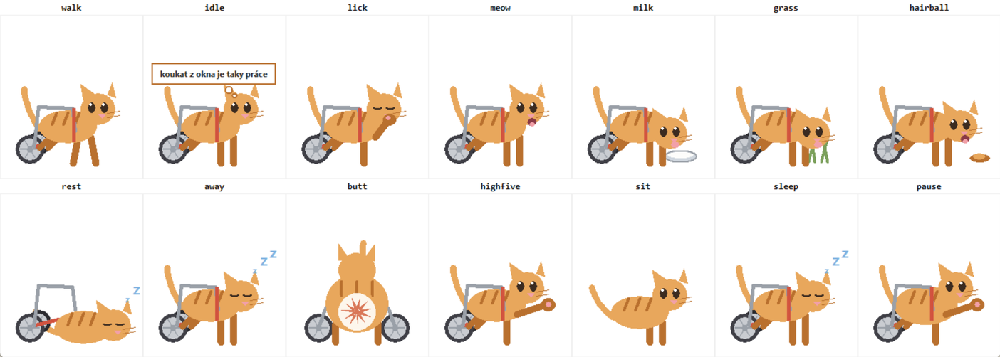
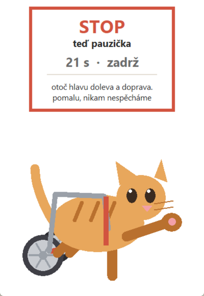

# Kočička

[](https://github.com/terezakohutova/kocicka/actions/workflows/ci.yml)

A desktop cat in a wheelchair who keeps you company while you work, and makes
you get up from the desk once an hour.

*Kočička* (roughly KOH-chich-kah) is Czech for "kitty". She speaks Czech for now; see [Language](#language).

One file. No dependencies beyond the Python standard library. No installer,
no account, no telemetry, nothing leaves your machine.



> 🇨🇿 Česká verze návodu je níž: [Česky](#česky)

---

## Why another desktop pet

Most desktop pets are decoration. This one actually looks after you:

- **She counts an hour of real work, not an hour on the clock.** If you walk
  away from the desk for five minutes or more, she stops counting and naps,
  and when you come back that time away counts as your break, so the hour
  starts again. A laptop that was asleep does not count as work either. She
  knows you left on Windows, on macOS, and on Linux under X11 with
  `xprintidle` installed. Anywhere else (Wayland, or no `xprintidle`) she
  cannot tell, so there it is an hour on the clock while she runs.
- **She remembers today's count.** Restart her (or the computer) and she
  picks up the day's work time where she left off; the next day starts fresh.
- **She gets out of the way of fullscreen apps.** When the window in front
  fills its whole monitor without a title bar (a slideshow, a fullscreen call
  or video, a game), she hides until it stops being fullscreen. That is all
  she can see: she cannot tell whether you are sharing your screen, so if you
  share an ordinary window or your whole desktop, she stays put. Your work
  time keeps counting while she is hidden, and a break that comes due waits
  until she is back.
- **Her breaks are guided.** Every hour she grows, holds up a STOP sign and
  counts down 30 seconds, walking you through a different stretch every few
  seconds while her body breathes in a 4-7-8 rhythm you can follow. If the
  timing is bad, right click to skip that one or push it back 10 minutes
  (on the clock, whatever you do in between).
- **Night owls get breaks too.** From 22:00 to 07:00 she dozes and keeps
  quiet, but your work still counts and the hourly break still comes. The
  end-of-day sign never shows at night.
- **She asks what the one thing is today**, keeps it in her menu, and lets
  you tick it off.
- **She tracks your water** and gets pointed about it in the afternoon.
- **She tells you to stop working** once a day, after 16:00 and only once
  you have put in half an hour of work that day, then lies down. A click puts
  the sign down; right click pushes it back 10 minutes.

And in between all that she rolls around, grooms a paw, meows, drinks milk,
eats grass, coughs up a hairball, climbs out of her cart for a nap, and
occasionally turns around and shows you her backside.

<p align="center"></p>

## About her cart

Rear-wheel carts are a real mobility aid for cats whose back legs do not carry
them, and cats get around in them happily. She is drawn the way those carts
actually work: her hind legs ride in a sling, a strap goes round her chest,
the wheels turn as she rolls, and when she wants a proper nap she climbs out
and lies down next to it. Nothing she says is about the cart, and none of her
jokes are at its expense. She is a cat with a cart, not a joke about one.

If you would rather have her on four legs, untick the cart in her menu.

## Running her

You need **Python 3** with tkinter, which the python.org and Microsoft Store
installers include. Nothing else.

```
python kocicka.py
```

On the first run she asks for a colour and a name, then remembers both in
`kocka.json` in your per-user config folder and comes back the same cat every
time:

| | |
|---|---|
| Windows | `%APPDATA%\kocicka\kocka.json` |
| macOS | `~/Library/Application Support/kocicka/kocka.json` |
| Linux | `$XDG_CONFIG_HOME/kocicka/kocka.json` (usually `~/.config/kocicka/`) |

Older versions kept it next to the script; she copies it over on the first
start and leaves the old file alone, so you can delete it. Every save goes to
a temporary file first and then replaces the real one, and the previous
version is kept as `kocka.json.bak`. If the folder cannot be written, she
says so once in her speech bubble and carries on without remembering.

On Windows, double-click `kocicka.bat`; it starts her with `pythonw`, so no
console window stays open. To have her start with the machine, put a shortcut
to that `.bat` in `shell:startup`.

On Linux, some distributions ship tkinter separately (`sudo apt install
python3-tk` on Debian and Ubuntu).

## Controls

| | |
|---|---|
| **Left click** | she gives you a paw and says something; on the end-of-day sign, puts it down |
| **Drag** | move her along the screen |
| **Right click** | today's one thing, come here, high five, milk, I drank, say something, take a break, skip the break, break in 10 minutes, cart on/off, rename / recolour, close |

## Platform support

She runs anywhere Python and tkinter do, but two of the good parts are
Windows-only and degrade quietly elsewhere:

| | Windows | macOS / Linux |
|---|---|---|
| Transparent background | yes | no, she sits on a small cream card |
| Knowing you left the desk | yes | macOS: yes (`ioreg`). Linux: only under X11 with `xprintidle` installed; otherwise she assumes you are always there |
| Hiding behind fullscreen apps | yes | no |
| Standing on the taskbar, wherever it is | yes, from the work area | assumes a bar 40 px tall at the bottom |
| Sharp on high-DPI displays | yes, she scales with the display | depends on Tk |
| Everything else | yes | yes |

She lives along the bottom of the main monitor.

The tests run on Windows, macOS and Linux in CI, but day to day she has only
been lived with on Windows. Under Wayland her borderless window may not stay
where she puts it. Patches for the macOS and Linux equivalents are very
welcome - see [CONTRIBUTING.md](CONTRIBUTING.md).

## Privacy

There is no networking code in `kocicka.py` at all: no `socket`, `urllib` or
`http`, which you can check with a quick search. What she does touch:

- **`kocka.json`** in your config folder (see above): her name and colour,
  the day you met, today's one thing, today's water count, and how long you
  have worked today (so a restart keeps it).
- **`kocka.lock`** next to it, outside Windows: the process id of the copy
  that is running, so a second copy does not start. On Windows a named mutex
  does the same job and no file is written.
- **On macOS and Linux, one small local program** every few seconds, to ask
  how long since the last key press or mouse move: `ioreg -c IOHIDSystem` on
  macOS (she reads only `HIDIdleTime` from it), `xprintidle` on Linux if it
  is installed. That is the only `subprocess` in the file.
- **On Windows, a few questions to the OS**, once a second: how long since
  the last key press or mouse move (`GetLastInputInfo`, a single timestamp,
  never which keys); whether the window in front fills its monitor
  (`GetForegroundWindow`, its style, its rectangle, `MonitorFromWindow` and
  `GetMonitorInfoW`, plus its class name only to tell the desktop wallpaper
  apart, never its title or contents); and where the taskbar leaves room
  (`SystemParametersInfoW`).

## Configuration

The constants at the top of `kocicka.py` are meant to be edited:

| | |
|---|---|
| `WORK_END = 16` | the hour she tells you to close the laptop |
| `PAUSE_EVERY = 3600` | seconds of real work between breaks |
| `PAUSE_SECS = 30` | how long a break lasts |
| `WATER_GOAL = 6` | glasses before she stops nagging |
| `AWAY_AFTER = 300` | seconds of no input before she assumes you left; time away counts as your break |
| `SNOOZE = 600` | how far "break in 10 minutes" pushes it, on the clock; the menu wording follows it |
| `END_AFTER_WORK = 1800` | work today before the end-of-day sign can show |
| `NIGHT = (22, 7)` | when she dozes: no pep talks or end-of-day sign, but work still counts and breaks still come |
| `TASKBAR = 40` | macOS and Linux only: raise this if she overlaps your dock or panel |

## Language

All the text she shows, from her pep talks to the menu and the signs, lives
in one table, `STRINGS`, at the top of `kocicka.py` (a test checks that no
Czech has crept in anywhere else). It is Czech only for now, and it talks to a
woman: Czech grammar marks it ("napila jsem se", "ty bys neměla"). There is no
language switch yet. A few lines, to give you the voice:

| | |
|---|---|
| *devět životů, dneska stačí zvládnout ten jeden* | nine lives, today you only need to get through this one |
| *pauza není lenost, je to strategie. zeptej se koček* | a break is not laziness, it is strategy. ask any cat |
| *ramena dozadu a dolů. celý den je držíš u uší* | shoulders back and down. you've had them by your ears all day |

An English table, written in her voice rather than translated word for word,
is the most useful contribution anyone could make.

## Checking it works

```
python kocicka.py --selftest              # a quick check, then tests/ if it is next to her
python -m unittest discover -s tests      # the test suite (drawing tests need a display)
ruff check .                              # lint, as CI runs it
python tools/pose.py                      # every pose side by side, to check the drawing
python tools/pose.py break                # the break sign, frozen mid-countdown
python kocicka.py --demo                  # speeds the timers up so you see a break now
```

CI runs the same on Windows, macOS and Linux, and also checks that `KOCICKA.md`
still matches the source.

---

## Česky

Kočička na vozíčku, která ti jezdí po spodku obrazovky, dělá ti společnost
při práci a jednou za hodinu tě zvedne od stolu.

Jeden soubor, jen standardní knihovna Pythonu. Nic neinstaluje, nic neposílá
na internet, nic o tobě nesbírá.

**Co potřebuješ:** Python 3. Najdeš ho v Microsoft Store (hledej „Python 3")
nebo na [python.org](https://www.python.org/downloads/) - tam při instalaci
zaškrtni „Add python.exe to PATH".

**Jak ji pustit:** dvojklik na `kocicka.bat`. Při prvním spuštění si vybereš
barvu a jméno, pak už naskakuje rovnou. Kdo nechce řešit GitHub, pošli mu
[`KOCICKA.md`](KOCICKA.md): je v něm celý návod i celý kód v jednom souboru.

**Co dělá:** projíždí se, olizuje se, mňouká, pije mlíčko, žere trávu a
vyblije chlupy, občas vyleze z vozíku a zdřímne si vedle něj. Každých pár
minut ti řekne něco povzbuzujícího. Jednou za hodinu **skutečné práce** tě
zastaví, zvedne ceduli STOP a vede tě protahováním a dýcháním 4-7-8.
Odpoledne ti řekne, ať to zavřeš. Pozná, když nejsi u počítače, a schová se,
když je vepředu aplikace přes celou obrazovku (prezentace, hovor nebo video
na celou obrazovku). Jestli sdílíš obrazovku, poznat neumí: když sdílíš
obyčejné okno nebo celou plochu, zůstane vidět.

**Chceš přispět?** Viz [CONTRIBUTING.md](CONTRIBUTING.md). Nejvíc by teď
pomohly překlady hlášek a podpora macOS a Linuxu.

---

MIT, viz [LICENSE](LICENSE).
